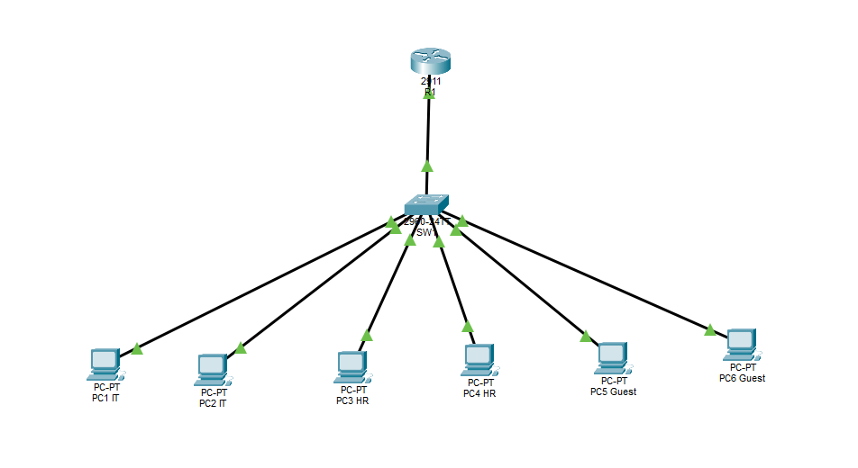

# Small Business Network Infrastructure

A practical small business network infrastructure project built using **Cisco Packet Tracer**. The project demonstrates VLAN segmentation, inter-VLAN routing, DHCP configuration, and network troubleshooting.

## Network Topology

### Network Devices
- 1 × Cisco 2911 Router (R1)
- 1 × Cisco 2960 Switch (SW1)
- 6 × End-user PCs

## VLAN and IP Addressing

| VLAN | Department | Network | Default Gateway | Devices |
|---|---|---|---|---|
| 10 | IT | 192.168.10.0/24 | 192.168.10.1 | PC1, PC2 |
| 20 | HR | 192.168.20.0/24 | 192.168.20.1 | PC3, PC4 |
| 30 | GUESTS | 192.168.30.0/24 | 192.168.30.1 | PC5, PC6 |

## Implemented Features

### VLAN Configuration
Configured three VLANs on the Cisco 2960 switch to separate IT, HR, and guest devices.

### Inter-VLAN Routing
Implemented Router-on-a-Stick using IEEE 802.1Q trunking between the router and switch.

### DHCP
Configured DHCP pools on the Cisco router to automatically assign IP addresses and default gateways to devices in each VLAN.

### Access Control Lists (ACL)
Configured an extended ACL intended to restrict guest network access to the IT and HR VLANs.

**Known limitation:** The ACL configuration is present, but guest traffic restrictions did not work as expected during testing. This issue remains unresolved.

## Network Troubleshooting

### Issue 1: Incorrect VLAN Assignment
- **Problem:** PC2 was incorrectly assigned to VLAN 20 instead of VLAN 10.
- **Diagnosis:** Used `show vlan brief` and ping tests to identify the issue.
- **Solution:** Reassigned switch port Fa0/2 to VLAN 10.
- **Result:** Connectivity to the default gateway was restored.

### Issue 2: Incorrect Default Gateway
- **Problem:** PC3 was configured with an incorrect default gateway.
- **Diagnosis:** Local VLAN communication worked, but communication with other VLANs failed.
- **Solution:** Corrected the default gateway to `192.168.20.1`.
- **Result:** Inter-VLAN connectivity was restored.

## Verification

- Successful communication between devices within the same VLAN.
- Successful inter-VLAN connectivity after router configuration.
- DHCP successfully assigned network settings.
- Both simulated network faults were diagnosed and resolved.
- Guest network ACL enforcement remains unverified.

## Tools and Technologies

- Cisco Packet Tracer
- Cisco IOS CLI
- VLANs and IEEE 802.1Q
- IPv4 Addressing
- DHCP
- Access Control Lists
- ICMP and Network Troubleshooting

## Project Files

- `Project02_Small_Business_Network.pkt` — Cisco Packet Tracer project file
- `network-topology.png` — Network topology diagram

## Project Purpose

This project was created to develop practical skills in network infrastructure configuration, troubleshooting, and technical documentation, with a focus on entry-level network engineering and IT infrastructure roles.
